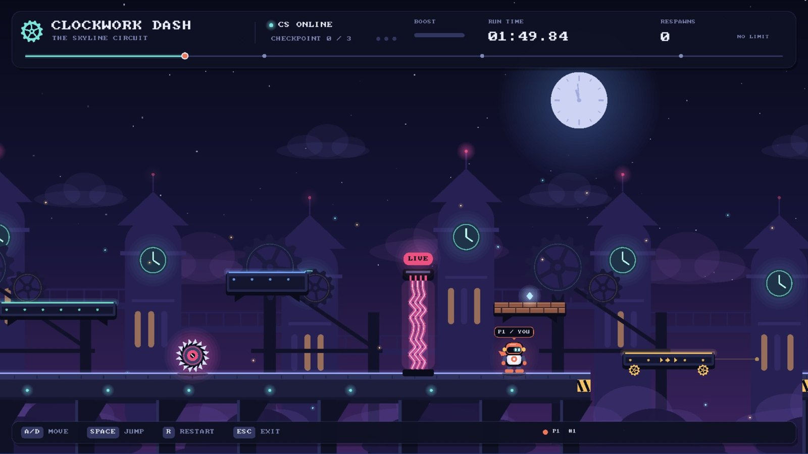
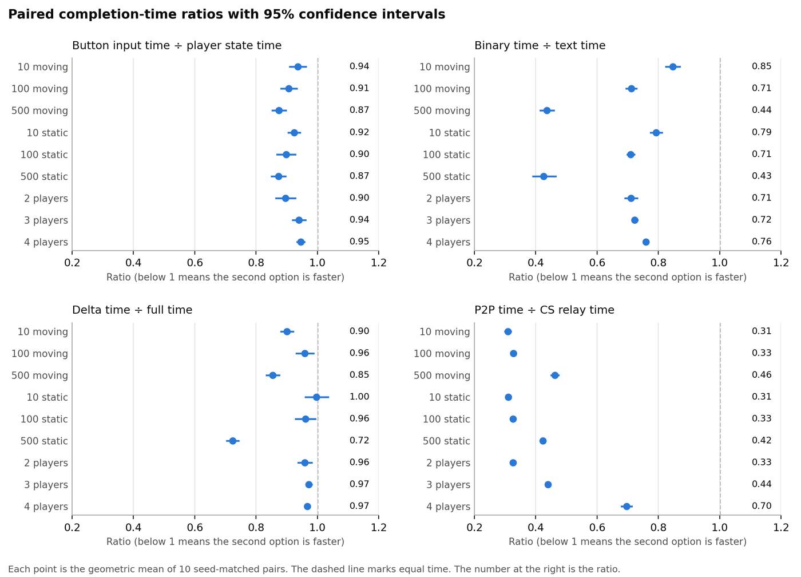
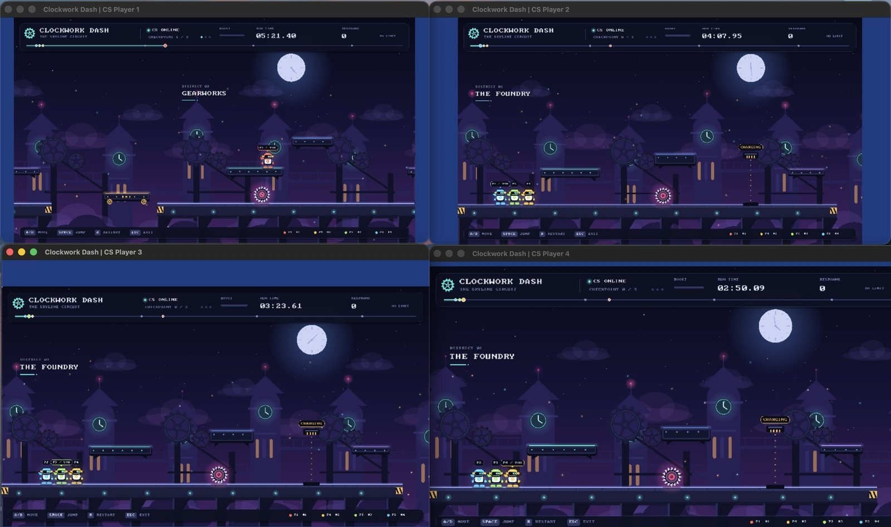
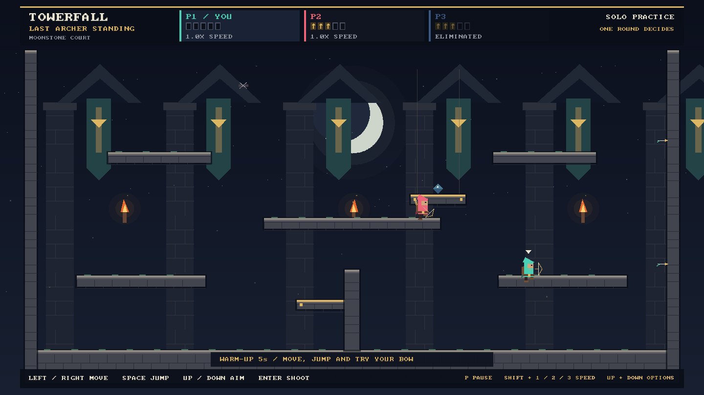
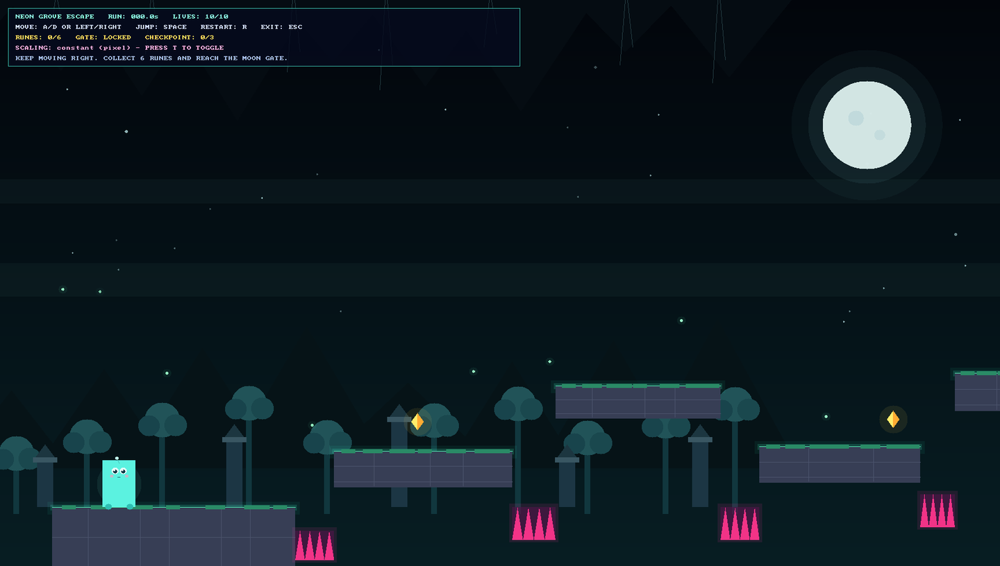

<div align="center">

# Beyond the Game Loop

**Three 2D games I built in C++17 on an engine my team and I wrote from scratch.**<br>
Real-time multiplayer across three network models, a component-based object model,<br>
and a 720-run benchmark to measure which networking choices actually pay off.




<sub><b>Clockwork Dash</b>, my Milestone 3 game, running in client-server mode.</sub>

</div>

## At a glance

| 3 | 3 | 4 | 720 | 14 |
| :---: | :---: | :---: | :---: | :---: |
| playable games | network models: client-server, hybrid, peer-to-peer | players per session, max | seed-matched benchmark runs | headless engine test programs |

## Engineering highlights

- **Multiplayer three ways.** Authoritative client-server, a hybrid model, and serverless peer-to-peer, all over ZeroMQ. Peers agree on a shared clock by gossip and replay a shared event log deterministically, so every screen reaches the same result without a server deciding it.
- **Built to survive disconnects.** Heartbeats, timeouts, and per-session IDs mean a crashed client is cleaned up automatically and a returning one can't take over a slot that now belongs to someone else. The socket layer never throws, so a vanished server can't crash a client.
- **A component-based object model.** Game objects are IDs plus components, and systems supply the behavior. The same simulation code runs in solo play, on a server, or on a peer, with authority filters deciding who may change what.
- **Snapshot replication.** Worlds are synced with text or binary encoding and full or delta snapshots with periodic keyframes, using a component registry with 16-bit wire IDs.
- **Time and threads.** Chainable timelines that pause and scale from 0.5× to 2×, a background update thread beside the render loop, and a persistent job pool.
- **Measured, not guessed.** Before trusting any timing, my benchmark harness checks that every endpoint's final world matches an offline simulation bit for bit. All 720 runs passed on the first attempt.

## What the benchmarks showed

I compared four networking choices in Clockwork Dash, changing one setting at a time across nine scene sizes and player counts, with ten seed-matched runs per side.

| Comparison | What I found |
| --- | --- |
| Direct peer-to-peer vs. client-server relay | **30–69% faster.** The relay's blocking request-reply hop dominated. |
| Binary vs. text encoding | **15–57% faster**, with snapshots 42% smaller. The gap grows with scene size. |
| Delta vs. full snapshots | **Up to 28% faster** when most of the world is static, despite 10–30% more encoding work. |
| Sending button input vs. full player state | **5–13% faster**, because clients no longer simulate the whole world. |

<p align="center">
  
</p>

The full methodology, results, and design trade-offs are in my [Milestone 3 report](milestone3/report_sbangal6.pdf).

## The games

### Clockwork Dash · [Milestone 3](milestone3/README.md)

A time-trial platformer for up to four racers. Hit three checkpoints in order, dodge saws and electric barriers, and bump copper ledges to reveal potions that give you a seven-second boost. Land on another runner's head to take theirs away.



I built the race on the engine's component model with nine game-specific components, and kept one shared simulation for solo, client-server, and peer-to-peer play. In peer-to-peer mode, an event log settles contested moments, such as two runners claiming the same potion, identically on every screen.

### Towerfall · Moonlit Trials · [Milestone 1](milestone1/README.md)

Arena archery for two to four players. Wall-jump between ledges, make every arrow count, and be the last archer standing to claim the diamond.



Matches run in any of the three network models. Inputs carry timestamps and feed a shared event journal, so matches can be replayed and the peers can verify the round result together. You can pause or switch between 0.5×, 1× and 2× speed while playing, and a telemetry overlay shows the engine at work.

### Neon Grove Escape · [Milestone 2](milestone2/README.md)

A solo scrolling platformer through a glowing forest of fungal ruins. Collect six runes to unlock the Moon Gate, with checkpoints and ten lives to get you there.



Every visual, from the scenery to the fireflies and particle trails, is drawn in code. Movement has acceleration, air control, and buffered jumps, and you can switch between pixel and proportional scaling mid-run.

## Run it yourself

Each milestone folder is self-contained, with its own copy of the engine. I've built and run everything on macOS.

```sh
brew install cmake sdl3 sdl3_image zeromq cppzmq pkg-config

git clone https://github.com/smruthibt/beyond-the-game-loop.git
cd beyond-the-game-loop/milestone3
cmake -S . -B build -DCMAKE_BUILD_TYPE=Release
cmake --build build --parallel
./build/clockwork_dash
```

| Folder | Build directory | Run |
| --- | --- | --- |
| `milestone1/` | `build-towerfall` | `./build-towerfall/game/towerfall` |
| `milestone2/` | `build` | `./build/neon_grave_escape` |
| `milestone3/` | `build` | `./build/clockwork_dash` |

<details>
<summary><b>Full build requirements</b></summary>

| Requirement | Milestone 1 | Milestone 2 | Milestone 3 |
| --- | --- | --- | --- |
| C++17 compiler | ✓ | ✓ | ✓ |
| CMake | 3.16+ | 3.10+ | 3.16+ |
| SDL3 and SDL3_image | ✓ | ✓ | ✓ |
| libzmq, cppzmq, and pkg-config | ✓ | — | ✓ |
| Python 3 | Launcher and multiplayer tests | — | Benchmark scripts |
| matplotlib | — | — | Benchmark charts |

Milestone 1's Python tools expect the `build-towerfall` directory. Other platforms are untested; the [engine guide](milestone3/engine/README.md#build) lists Linux package names.

</details>

Each milestone's README covers controls, local multiplayer, and tests. For the engine's API, see the [engine guide](milestone3/engine/README.md).

---

<div align="center">

Built by **Smruthi Bangalore Thandava Murthy** for CSC 581, on the engine I wrote with Team 16.

</div>
